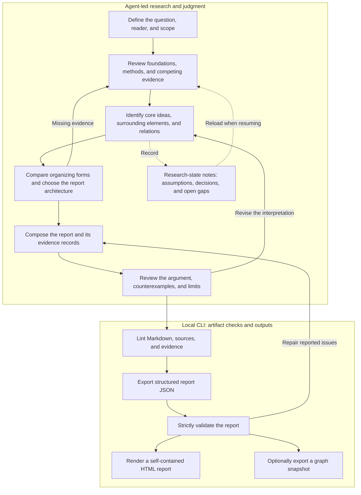

# Structure of Knowledge (SoK)

**Understand how a field holds together—and turn that understanding into a useful,
traceable research artifact.**

SoK combines a model-independent research skill in the [Agent Skills format](https://agentskills.io/specification)
with a local Rust CLI. The skill guides an
agent through source review, identification of a field's central ideas and their
surrounding context, and the design of a report for a particular reader. The CLI
organizes the resulting records, checks their consistency, and produces reusable
JSON, HTML reports, and optional graph snapshots.

Its starting point comes from Jerome Bruner's structure-of-knowledge curriculum
tradition: understanding a field involves its organizing ideas, their relationships,
and the ways the field establishes and revises knowledge. SoK applies that approach
to research, explanation, learning, and downstream reuse.

## Cognitive Layers

SoK was designed around multiple cognitive layers: levels of abstraction that
connect a working scaffold to higher-level interpretations and adaptations. The
scaffold establishes the research foundation—scope, sources, core elements,
relationships, and evidence standards. Within it, domain judgment brings those
findings together into an understanding of how the field holds together and what
remains uncertain. Higher-level work builds on that understanding to choose an
explanatory structure and adapt it into a report, curriculum, textbook plan, or
research handoff for a particular reader and goal.

These layers support revision in both directions: new evidence can change the
interpretation, while designing an explanation can reveal gaps that send the agent
back to the scaffold. This makes SoK a layered research-reasoning system with its
own organization, independent of any particular cognitive-architecture framework.
The [research workflow](structure-of-knowledge/SKILL.md#workflow) describes how the
agent moves between these levels.

## What You Can Do with SoK

| Goal | What SoK helps produce |
|---|---|
| Enter an unfamiliar field | A map of its core questions, ideas, methods, evidence standards, and important surrounding context. |
| Investigate a research question | A source-grounded report whose argument and section order follow the findings. |
| Evaluate a supplied corpus or case | Analysis that distinguishes the material being examined from the scholarship or standards used to evaluate it. |
| Choose what to read or learn | A purpose-based literature ladder, or a curriculum with prerequisites, practice, and progress criteria when requested. |
| Continue work across agents or sessions | Research notes, handoff briefs, and optional structured work exchanges that preserve scope, evidence gaps, and decisions. |
| Reuse findings in other tools | Validated report JSON, typed knowledge/evidence/pedagogy packages, and graph snapshots connecting explicitly reviewed report identities. |

The same findings can support a briefing, field map, textbook plan, or corpus plan.
The output depends on the task: a curriculum, frontier survey, or visualization is
included when it helps the reader.

## The Research Logic

**Let the field determine the report.** A field name supplies initial search hints.
Source review reveals the actual knowledge-bearing elements: concepts, cases,
objects, methods, representations, practices, instruments, institutions, datasets,
or disputes. The agent identifies the central ideas and the surrounding elements
needed to understand them, compares organizing forms, and then chooses the thesis
and narrative sequence. New findings can send it back to revise that choice.

**Examine both knowledge and its justification.** SoK distinguishes what a field
knows from how it warrants, disputes, and revises its claims. In an empirical field,
that may involve measurement and uncertainty; in a formal field, proof and
counterexample; in an interpretive field, sources, competing readings, and methods.
The documents being analyzed and the sources justifying an analytical framework
may play different roles.

**Preserve distinctions when simplifying presentation.** A concise report should
retain the assumptions, boundary conditions, technical distinctions, and competing
interpretations that affect its conclusions. Research depth and presentation
length are separate choices.

**Make evidence traceable.** Cataloging a source records that it exists. Reviewed
support connects a claim to a source passage or support note and a review date.
Supporting, qualifying, and contradicting evidence have different meanings;
uncertainty and disagreement remain part of the record.

**Maintain continuity during long research.** The skill guides the agent to keep a
compact research-state record and revisit relevant evidence, assumptions, decisions,
and unresolved disputes before synthesis or resumption.

See the [research protocol](structure-of-knowledge/references/research-protocol.md)
for the detailed approach.

## How the Work Flows



The agent performs the research and chooses the architecture. The CLI checks
structured records, references, evidence metadata, and other artifact contracts.

## Recent Functional Changes

- **Field-native reports.** New `sok-report/v2` exports preserve field elements and
  an explicit architecture decision. Authored narrative sections retain their
  order; legacy concept/method arrays remain compatibility views. Reports can
  follow a causal system, debate, chronology, case comparison, or another
  evidence-grounded structure.
- **More precise relationships.** Relations such as `supports`, `qualifies`,
  `contradicts`, `part_of`, and `represented_by` retain distinct meanings.
  Assertions with different identities, descriptions, or sources remain separate.
- **Explicit conflict review.** A claim can record how opposing evidence affects
  its interpretation. A valid conflict review can acknowledge a dispute without
  treating the opposing evidence as affirmative support.
- **Reuse across reports.** `export-graph` produces a portable snapshot with
  report-scoped identities, revision hashes, and evidence provenance. Reviewed
  identity links can connect entities across reports without merging them by name.
- **Structured handoffs and continuity.** Optional typed core inputs and
  WorkOrder/WorkResult exchanges support bounded collaboration. Research-state
  guidance preserves the assumptions and unresolved questions needed to resume
  longer investigations.

Public report v1 inputs remain readable. The
[machine contract](structure-of-knowledge/references/machine-contract.md) describes
optional inputs and compatibility; the
[graph contract](specs/graph-interchange.md) describes snapshot semantics and limits.
Older tools may not understand the newly supported relation kinds.

## Install or Update

On macOS or Linux, the installer requires Rust with Cargo, `curl`, and `tar`.
It downloads the selected Git revision, builds the CLI, and installs the skill and CLI
together in the Codex skills directory at `${CODEX_HOME:-$HOME/.codex}/skills/structure-of-knowledge`.

```bash
curl -fsSL https://raw.githubusercontent.com/perhyper/SoK/main/install.sh | sh
```

Run the installer again to update. To select a branch, tag, or commit, pass
`--ref <revision>` to the installer. Automated Windows installation is not yet
supported.

From a local checkout, install that checkout's skill and compiled CLI together:

```bash
make install
```

Verify the installed executable:

```bash
SOK_CLI="${CODEX_HOME:-$HOME/.codex}/skills/structure-of-knowledge/bin/sok"
"$SOK_CLI" --version
"$SOK_CLI" --help
```

## Start a Research Task

Once your agent has loaded the skill, give it a question, audience, and intended outcome.

```text
Use the structure-of-knowledge skill to investigate computational neuroscience for a
technical reader entering the field. Explain its core ideas and how experimental
methods, models, and evidence fit around them. Review competing perspectives
before choosing the report structure, and give me a focused reading path.
```

For an analysis of supplied documents, specify whether external scholarship is
wanted or the work must remain within the supplied corpus. For a curriculum,
include the learner's starting point and available time.

You can also generate a working scaffold directly from the repository:

```bash
make build
SOK_CLI="$PWD/cli/target/release/sok"
"$SOK_CLI" scaffold --field "computational neuroscience" \
  --learner "technical reader new to the field" \
  --goal "understand the core ideas and their evidence" \
  --output /tmp/sok-scaffold.md
```

The scaffold is a research canvas. Generating it does not perform source review
or determine the final report's table of contents. `handoff-report` prepares
that working material for another agent to continue.

## From Findings to a Report

After research and composition, use the resolved `$SOK_CLI` from either setup above:

```bash
"$SOK_CLI" lint --stage final --report report.md \
  --sources sources.csv --evidence reviewed-evidence.jsonl --strict
"$SOK_CLI" export-json --stage final --report report.md \
  --sources sources.csv --evidence reviewed-evidence.jsonl --output sok-report.json
"$SOK_CLI" validate-report --input sok-report.json --strict
"$SOK_CLI" render-html --input sok-report.json --output report.html
```

| Artifact | Purpose |
|---|---|
| Working notes and scaffold | Research planning, decisions, gaps, and continuity. |
| `report.md` | Authored narrative and structured input surfaces. |
| `sources.csv` | Bibliographic, access, and source-role metadata. |
| `reviewed-evidence.jsonl` | Reviewed evidence records used to link sources and claims. |
| `sok-report.json` | Structured source of truth for validation and downstream tools. |
| `report.html` | Self-contained reader-facing view of a human report. |
| Optional core, run, and work files | Typed inputs, reproducibility records, and bounded work exchanges. |

Public headings can follow the report's argument. Markers or typed
inputs identify structured surfaces without imposing a universal table of contents.
Private planning context and run/work metadata remain outside the public report.

See the [output contract](structure-of-knowledge/references/output-contract.md)
for authoring formats and the
[CLI workflow](structure-of-knowledge/references/cli-workflow.md) for command details.

## Connect Findings Across Reports

Create a collection manifest alongside your reports:

```json
{
  "schema_version": "sok-graph-input/v1",
  "reports": [
    {"report_id": "quantum-sensing", "path": "sensing/sok-report.json"},
    {"report_id": "quantum-information", "path": "information/sok-report.json"}
  ]
}
```

```bash
"$SOK_CLI" export-graph --input collection.json --output graph.json
```

Input reports must pass strict validation. Each entity is scoped to its report
and exact revision; equal names or local IDs do not imply equivalence. Explicitly
reviewed links can record equivalence, relatedness, or difference across reports.

See the [graph input schema](specs/sok-graph-input.schema.json) for the manifest and
identity-link format.

## Other Tools

Run `"$SOK_CLI" <command> --help` for options.

| Task | Commands |
|---|---|
| Set up and scope work | `init`, `brief`, `scaffold`, `specificity` |
| Prepare a handoff | `handoff-report`, `work` |
| Manage sources | `source-template`, `audit-sources`, `download-sources`, `ingest last` |
| Check and publish local artifacts | `lint`, `export-json`, `validate-report`, `render-html` |
| Reuse and maintain structured data | `export-graph`, `migrate-ids` |
| Check saved contract fixtures | `eval conformance` |

Source downloads follow declared access permissions; paid or restricted sources
normally remain metadata-only. `ingest last` produces cataloged candidates and
**overwrites its output**, so keep reviewed evidence in a separate file.

## Development

The portable skill lives in `structure-of-knowledge/`; the Rust crate lives in
`cli/`. Installed skills contain the compiled `bin/sok` executable, without Rust
sources or build artifacts. Contracts live in [specs/](specs/).

```bash
make test
make vet
make test-install
make build
```

The [blueprint](https://github.com/perhyper/SoK/blob/main/BLUEPRINT.md) describes the project's educational aims and the scholarship behind them.

## License

[MIT](LICENSE).
